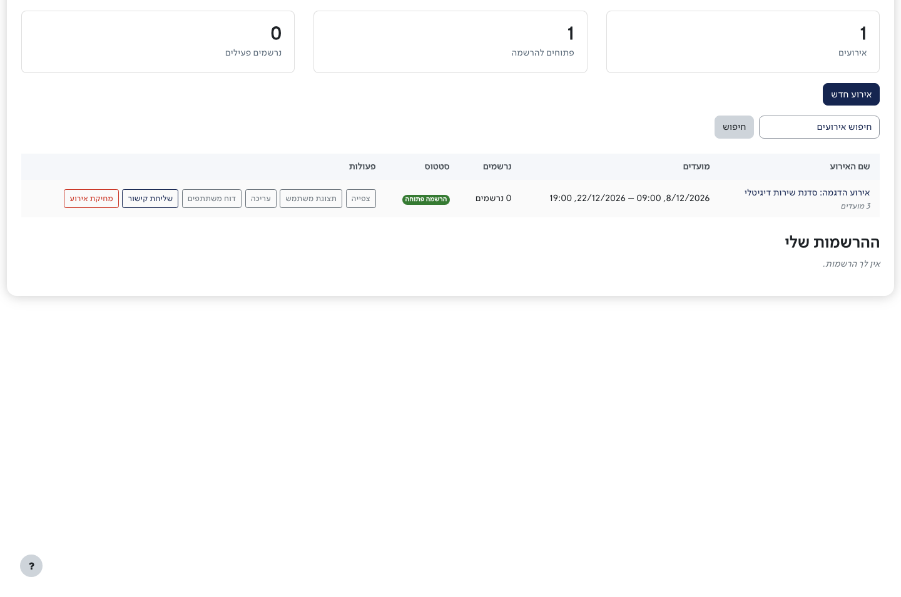
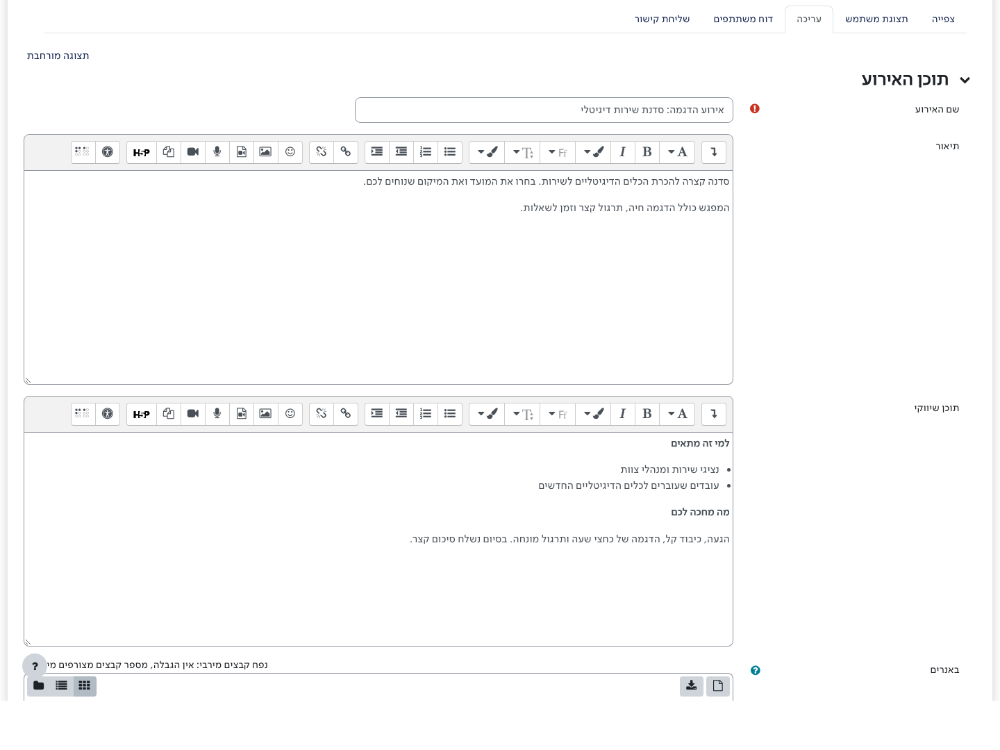
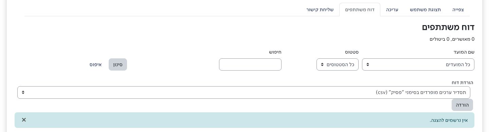

# הרשמה לאירועים

תוסף Moodle מקומי (`local_eventbooking`) לניהול אירועים ומפגשים. מנהל המערכת יוצר אירוע עם מועדים, מקומות ומגבלת משתתפים, והמשתמשים נרשמים מתוך חשבון Moodle שלהם.

נדרש Moodle 4.1 ומעלה.

## מה אפשר לעשות

- לפרסם אירוע עם תמונת כותרת, תיאור ותוכן שיווקי.
- להגדיר כמה מועדים לאותו אירוע, כל אחד עם מיקום ומגבלת מקומות.
- להגביל גם את מספר הנרשמים בכל האירוע. `0` משמעו ללא מגבלה.
- לאפשר למשתמש להירשם, לעדכן טלפון או לעבור מועד, ולבטל הרשמה.
- שם, שם משפחה, מספר זיהוי ודוא"ל נלקחים מהחשבון ואינם ניתנים לשינוי בטופס. רק הטלפון נערך.
- לצפות בטופס בדיוק כפי שמשתמש רגיל רואה אותו.
- להפיק דוח משתתפים ולייצא אותו.
- להעתיק קישור הרשמה לאירוע, או לשלוח אותו בדוא"ל.
- כשמוגדר חיבור ל-Outlook, הרשמה שולחת הזמנת פגישה שתופסת את השעה ואת המיקום ביומן. דחיית ההזמנה מפנה את המקום בסדנה.

יצירה, עריכה, דוח ושליחת קישור שמורים למנהלי המערכת. משתמש רגיל יכול לצפות ולהירשם בלבד.

## התקנה

1. ארזו את תיקיית `eventbooking` לקובץ ZIP, כך שהקובץ `version.php` נמצא בתוך התיקייה הראשית של החבילה.
2. באתר: ניהול המערכת ← תוספים ← התקנת תוספים.
3. העלו את קובץ ה-ZIP ובחרו בסוג `local` אם המערכת לא מזהה אותו לבד.
4. המשיכו לשדרוג מסד הנתונים.

אחרי עדכון של התוסף יש להעלות ZIP חדש. אתר שכבר מותקן בו התוסף ישדרג אותו אם מספר הגרסה גבוה יותר.

## מסכים

### ניהול האירועים

מסך מרכזי לכל האירועים: סטטוס, מועדים, מספר נרשמים, וקיצורי דרך לצפייה, עריכה, דוח, שליחת קישור ותצוגת משתמש.

### עמוד ההרשמה

העמוד נפתח בלי הכותרת והכותרת התחתונה של Moodle. התמונה הראשונה משמשת כותרת לרוחב העמוד, והטקסט יושב עליה. מתחתיה התוכן השיווקי וכרטיסי בחירת המועד.

### עריכת אירוע

שם, תיאור, תוכן שיווקי, באנרים, מגבלות, ומועדים. אפשר להוסיף עד חמש תמונות. הראשונה היא תמונת הכותרת.

### דוח משתתפים

סינון לפי מועד וסטטוס, חיפוש, והורדה לקובץ.

## יומן Outlook

בהגדרות התוסף, תחת «יומן Outlook», ממלאים יישום Microsoft 365 ותיבת דואר שממנה נשלחות ההזמנות. נדרשת הרשאת יישום `Calendars.ReadWrite` עם הסכמת מנהל. מומלץ להגביל את היישום ב-Exchange לתיבה הזו בלבד.

הרשמה יוצרת פגישה עם שם המפגש והמיקום. מעבר למועד אחר מעדכן את אותה פגישה. ביטול הרשמה באתר מבטל את הפגישה ביומן. משימה מתוזמנת, כל רבע שעה, בודקת אם העובד דחה את ההזמנה. דחייה מפנה את המקום בלי לשלוח ביטול נוסף. שינוי שם, שעה או מיקום מתעדכן ביומן בריצה הבאה של המשימה.

אם Outlook אינו זמין, ההרשמה באתר נשמרת בכל זאת. בלי ההגדרות האלה לא נשלחת הזמנה.

## הרשאות

| יכולת | מי מקבל כברירת מחדל |
| --- | --- |
| `local/eventbooking:manage` | מנהלי מערכת בלבד |
| `local/eventbooking:view` | כל המשתמשים |
| `local/eventbooking:register` | כל המשתמשים |

אפשר להעניק את יכולת הניהול לתפקיד נוסף, אבל היא אינה מוענקת אוטומטית לאף תפקיד.
